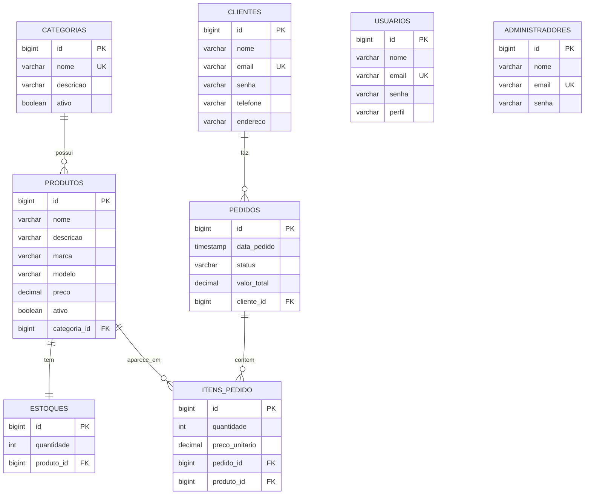

# Clothes4Happiness — API REST de E-commerce de Eletrônicos (Projeto B)

API REST para gerenciar **produtos, categorias, estoque, clientes e pedidos** de uma loja de eletrônicos.
SENAI — Desenvolvimento de Sistemas — SA4 Etapa 2.

**Integrantes:** Luiz Gustavo Souza Santos, Maria Eduarda de Sousa Gomes, Mariany Rodrigues da Boa Morte.

## Tecnologias
Java 21 · Spring Boot 4.1.2 · Spring Web · Spring Data JPA / Hibernate · H2 · Bean Validation · Spring Security · JWT (`com.auth0:java-jwt`) · BCrypt · Maven.

## Como executar
1. Abrir a pasta do projeto no IntelliJ IDEA (a pasta que contém o `pom.xml`) e aguardar o Maven baixar as dependências.
2. (Opcional) Definir a variável de ambiente `JWT_SECRET` em *Run → Edit Configurations → Environment variables*.
   Se não for definida, a aplicação gera uma chave aleatória a cada execução (os tokens deixam de valer ao reiniciar).
3. Executar `Clothes4happinessApplication`. A API sobe em `http://localhost:8080`.

## Banco de dados
- H2 em memória: `jdbc:h2:mem:clothes4happiness_db` (usuário `sa`, senha vazia). Console: `http://localhost:8080/h2-console`.
- As tabelas são criadas pelo Hibernate (`ddl-auto=create-drop`) e o arquivo `data.sql` carrega dados de exemplo a cada execução.
- Nenhuma senha real nem chave JWT fica no repositório.

## Entidades e relacionamentos
| Relacionamento | Tipo | Chave estrangeira |
|---|---|---|
| Categoria → Produtos | 1:N | `produtos.categoria_id` |
| Produtos → Estoque | 1:1 | `estoques.produto_id` (única) |
| Cliente → Pedido | 1:N | `pedidos.cliente_id` |
| Pedido → ItemPedido | 1:N | `itens_pedido.pedido_id` |
| Produtos → ItemPedido | 1:N | `itens_pedido.produto_id` |

**N:N:** Pedido ↔ Produto é um N:N, mas a associação possui atributos próprios (quantidade e preço unitário).
Por isso foi modelada com a entidade intermediária **ItemPedido**, e não com `@ManyToMany`.

Enums: `StatusPedido` (PENDENTE, CONFIRMADO, CANCELADO, CONCLUIDO) e `Perfil` (ADMIN, OPERADOR).



## Regras de negócio
- Um item só é adicionado se houver **estoque suficiente**; caso contrário retorna **409** (regra sugerida no PDF).
  A verificação, a baixa e a devolução ficam centralizadas no `EstoqueService` (`verificarEstoque`, `baixarEstoque`, `devolverEstoque`), que lança `EstoqueInsuficienteException`.
- Ao adicionar um item, o **estoque é baixado**, o **preço do produto é copiado** para o item e o **valor total do pedido** é recalculado.
- Itens só podem ser adicionados/removidos de pedidos **PENDENTES**; remover um item devolve o estoque.
- Ao **cancelar** um pedido, o estoque de todos os itens é devolvido. Pedidos CANCELADOS ou CONCLUÍDOS não mudam mais de status.
- Só pedidos CANCELADOS podem ser excluídos.
- Produto inativo não pode ser vendido; categoria inativa não recebe produtos.
- Um produto possui no máximo um estoque (1:1). Nome de categoria e e-mails não se repetem.

## Transações e rollback (`@Transactional`)
`ItemPedidoService.adicionar`, `ItemPedidoService.remover`, `PedidoService.atualizarStatus` e `PedidoService.deletar`
alteram várias tabelas e são transacionais.

**Demonstração do rollback:** crie um pedido com itens de dois produtos diferentes (ex.: produto 1 e produto 2),
apague o estoque do produto 2 (`DELETE /estoques/2`, como ADMIN) e tente **cancelar** o pedido.
O cancelamento devolve o estoque do produto 1 e depois falha no produto 2 (404).
Como o método é `@Transactional`, a devolução do produto 1 é **desfeita**: `GET /estoques/produto/1` continua com a quantidade anterior.

## Autenticação (JWT)
1. `POST /auth/login` com e-mail e senha → retorna o token.
2. Enviar o token nas demais requisições no cabeçalho `Authorization: Bearer <token>` (no Postman: aba *Authorization → Bearer Token*).

Usuários de exemplo (criados pelo `data.sql`, senhas guardadas com BCrypt):

| Perfil | E-mail | Senha |
|---|---|---|
| ADMIN | admin@loja.com | admin123 |
| OPERADOR | operador@loja.com | operador123 |

| Acesso | Endpoints |
|---|---|
| Público | `POST /auth/login`, `GET /produtos/**`, `GET /categorias/**`, `/h2-console` |
| Somente ADMIN | `/usuarios/**`, `/administradores/**`, POST/PUT/PATCH em `/categorias` e `/produtos`, qualquer `DELETE` |
| ADMIN e OPERADOR | `/clientes`, `/estoques`, `/pedidos`, `/itens-pedido` (exceto DELETE) |

Sem token → **401**. Token de OPERADOR em rota de ADMIN → **403**.

## Endpoints
| Método | URL | Descrição |
|---|---|---|
| POST | /auth/login | Login, retorna JWT |
| GET / POST | /usuarios | Listar / cadastrar usuários (ADMIN) |
| GET | /categorias, /categorias/ativas, /categorias/{id} | Consultar categorias |
| POST / PUT | /categorias, /categorias/{id} | Cadastrar / atualizar |
| PATCH / DELETE | /categorias/{id}/inativar, /categorias/{id} | Inativar / excluir |
| GET | /produtos, /produtos/ativos, /produtos/{id}, /produtos/categoria/{id} | Catálogo |
| POST / PUT | /produtos, /produtos/{id} | Cadastrar / atualizar |
| PATCH / DELETE | /produtos/{id}/inativar, /produtos/{id} | Inativar / excluir |
| GET | /estoques, /estoques/{id}, /estoques/produto/{id} | Consultar estoque |
| POST / PUT / DELETE | /estoques, /estoques/{id} | Cadastrar / ajustar / excluir |
| GET / POST | /clientes | Listar / cadastrar |
| GET / PUT / DELETE | /clientes/{id} | Consultar / atualizar / excluir |
| GET | /pedidos, /pedidos/{id}, /pedidos/cliente/{id}, /pedidos/status/{status} | Consultar pedidos |
| POST | /pedidos | Criar pedido |
| PATCH | /pedidos/{id}/status | Alterar status |
| DELETE | /pedidos/{id} | Excluir pedido cancelado |
| GET / POST | /itens-pedido, /itens-pedido/pedido/{id} | Consultar / adicionar item |
| DELETE | /itens-pedido/{id} | Remover item |
| CRUD | /administradores | Administradores da loja |

Exemplos:
```json
POST /auth/login
{ "email": "admin@loja.com", "senha": "admin123" }

POST /produtos
{ "nome": "Galaxy A55", "marca": "Samsung", "modelo": "SM-A556", "preco": 2199.90, "categoriaId": 1 }

POST /pedidos
{ "clienteId": 1 }

POST /itens-pedido
{ "quantidade": 2, "pedido": { "id": 1 }, "produto": { "id": 1 } }

PATCH /pedidos/1/status
{ "status": "CONFIRMADO" }
```

## Erros
Erros conhecidos retornam JSON com `status`, `mensagem` e `dataHora`:
400 (dados inválidos), 401 (não autenticado / login inválido), 403 (sem permissão), 404 (não encontrado), 409 (regra de negócio).

## Testes
A coleção do Postman está em `Clothes4Happiness.postman_collection.json` (Postman → Import). Execute primeiro os logins: os tokens são salvos automaticamente nas variáveis da coleção.

## Limitações conhecidas
- Banco H2 em memória: os dados voltam ao estado do `data.sql` a cada execução.
- Estoque e Item do Pedido ainda usam a própria entidade como entrada/saída (DTOs criados para Categoria, Produto, Cliente, Pedido e Usuário).
- A senha de `Cliente` e `Administrador` é armazenada sem hash; o login da API é feito pela entidade `Usuario`, que usa BCrypt.
- Não há refresh token (não exigido) nem front-end.
